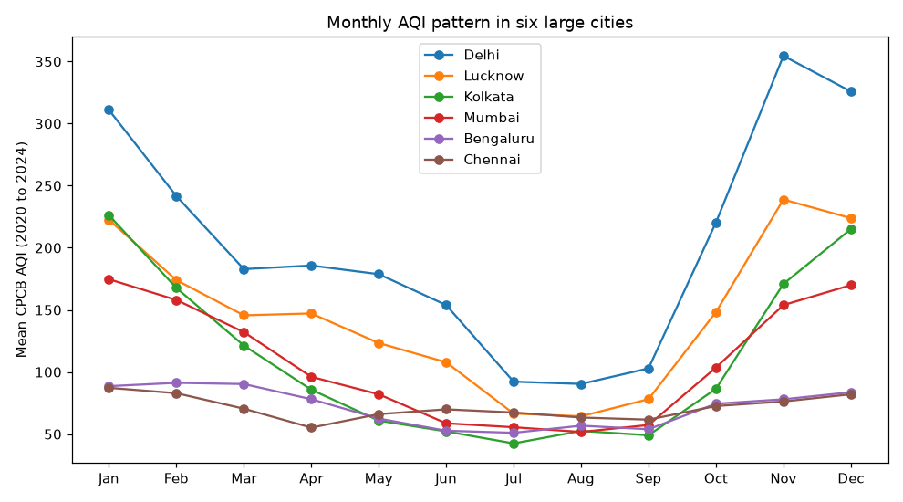
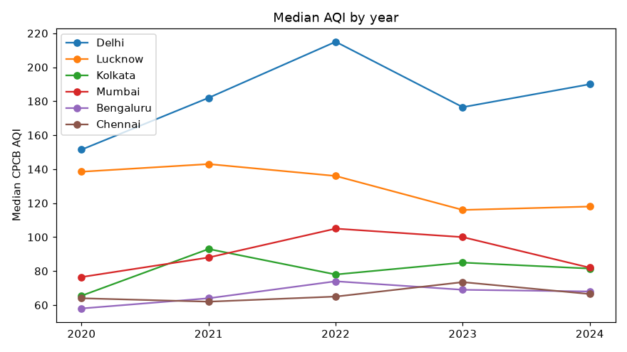
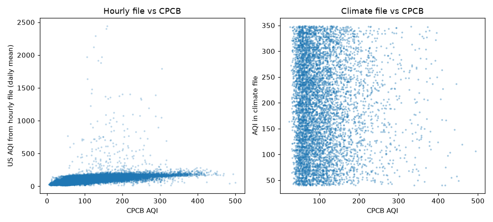
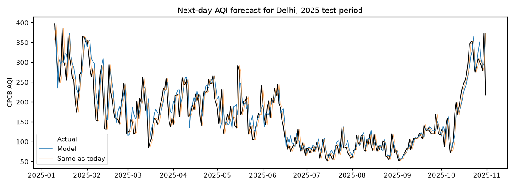
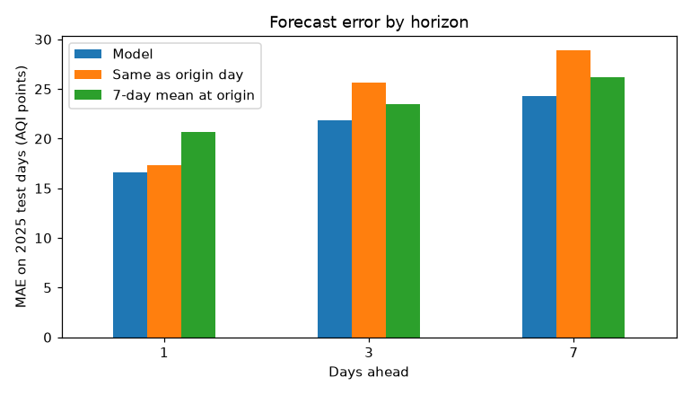
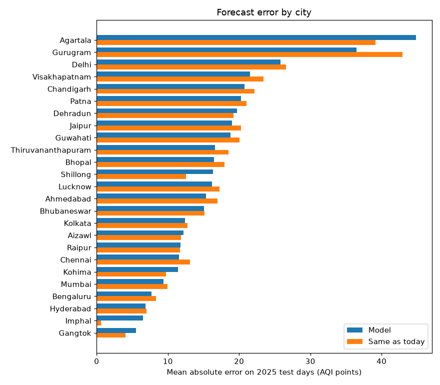
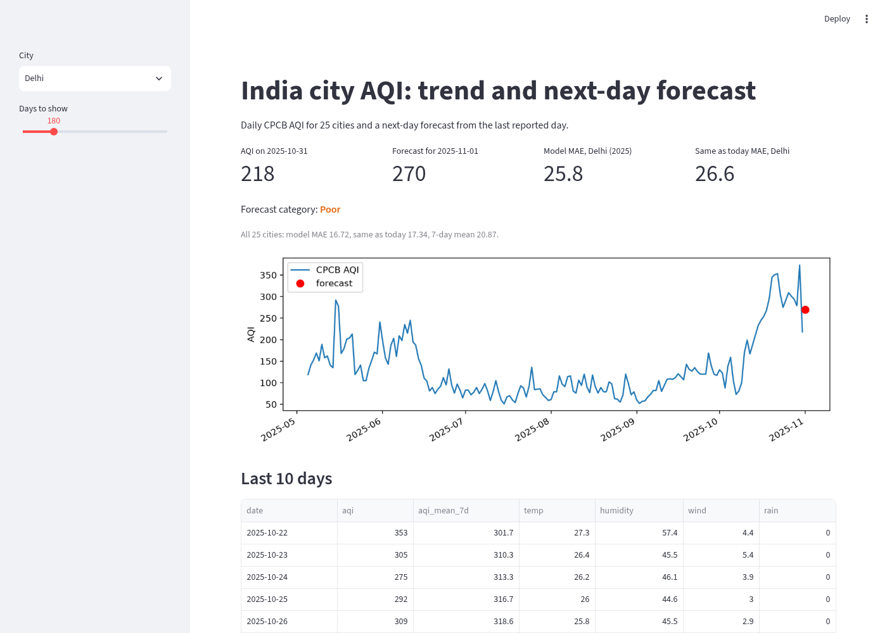

# India AQI analysis

A look at daily air quality in Indian cities using CPCB (Central Pollution Control Board) AQI bulletins from January 2020 to October 2025, plus a simple next-day AQI forecast for 25 cities that also have hourly weather data.

## Data

Three Kaggle datasets go in `data/raw/` (they are not in this repo):

| Source | File | Span | Size |
|---|---|---|---|
| [CPCB daily AQI bulletins](https://www.kaggle.com/datasets/krishnandansha/aqi-india-2020-to-2025-october) | AQI_2020_to_2025_October.csv | 2020-01-01 to 2025-10-31 | 378,328 rows, 295 cities after name cleanup |
| [Hourly weather and pollution](https://www.kaggle.com/datasets/bhautikvekariya21/air-quality-dataset-indian-cities-2022-2025) | INDIA_AQI_COMPLETE_20251126.csv | 2022-08-05 to 2025-11-26 | 842,160 hourly rows, 29 cities, 35,090 city-days |
| [Indian climate 2024 to 2025](https://www.kaggle.com/datasets/ankushnarwade/indian-climate-dataset-20242025) | Indian_Climate_Dataset_2024_2025.csv | 2024-01-01 to 2025-12-31 | 7,310 rows, 10 cities |

How many rows are kept at each step:

| Step | Rows |
|---|---|
| CPCB raw rows | 378,328 |
| CPCB city-days after fixing city spellings and averaging 34 duplicate rows | 378,294 |
| CPCB city-days for the 25 cities in both CPCB and the hourly file, from 2022-08-05 | 27,170 |
| Same cities reindexed to every calendar day (missing days left empty) | 28,885 |
| CPCB days that also have weather | 27,170 |
| Days usable for the forecast (today, the last 7 days and tomorrow all reported) | 23,689 |
| Climate file rows that match a CPCB city-day | 6,689 |

Cleaning notes:
- CPCB dates are day-first (`13-01-2020`). Reading them month-first silently throws away or swaps most dates.
- Some cities are spelled two ways in different years (Greater_Noida and Greater Noida, Kalaburgi and Kalaburagi, and so on). These are merged in `src/load.py`.
- The "Prominent Pollutant" column is `PM 2.5, PM 10` on every single row, so it carries no information and is not used.

## Findings

All of these come from `outputs/results.json` after running `python main.py`. Year and month comparisons use the full years 2020 to 2024.

1. **Winter is the problem season.** Across all cities, the worst month by median AQI is November and the best is July. In Delhi, mean AQI is 354.5 in November and 90.4 in August, about 4 times higher.
2. **Delhi had a "very poor" or worse day (AQI over 300) on 21.5% of days.**
3. **The worst cities are all around Delhi.** Among cities with at least 1,500 reported days, the highest mean AQI is Greater Noida (206.1), Delhi (203.2), Ghaziabad (198.8), Bhiwadi (194.1) and Faridabad (193.8).
4. **No clear yearly trend.** The median AQI across all cities was 88 (2020), 93 (2021), 97 (2022), 94 (2023) and 88 (2024).
5. **The other two sources do not agree with CPCB.** The daily mean US AQI from the hourly file correlates 0.47 with CPCB AQI (it uses a different scale). The AQI column in the climate file has a correlation of -0.02 with CPCB for the same city and day, so I did not use it for anything.





## Next-day forecast

Target: tomorrow's CPCB AQI for a city. Features known by the end of today: today's AQI, yesterday's, a week ago, the 7-day mean, month, day of week, city, and today's daily weather from the hourly file (temperature, humidity, wind, rain, pressure, PM2.5).

- Each city is reindexed to every calendar day so "yesterday" and "tomorrow" are really one day away. Days next to a gap are dropped instead of being filled.
- Train: 2022-08 to 2024-12. Test: all usable days in 2025 (2025-01-09 to 2025-10-30).
- Model: `HistGradientBoostingRegressor`. Learning rate and leaf count are picked with a 4-fold `TimeSeriesSplit` on the training data only. Missing weather values are filled with training medians.

Mean absolute error on the 5,894 test days:

| Method | MAE (AQI points) |
|---|---|
| 7-day mean | 20.87 |
| Same as today (persistence) | 17.34 |
| Model, AQI history only | 16.91 |
| Model, AQI history and weather | 16.72 |

The model beats persistence in 17 of 25 cities, but only by about 3.6% overall. Persistence is a strong baseline for daily AQI, and weather only adds a little.



### Longer horizons

One model per horizon, trained the same way: a forecast made at the end of day t for day t+h, using only features known on day t. To compare horizons fairly, only origin days that have a reported value 1, 3 and 7 days later are used, which leaves 5,574 test days (so the 1-day numbers differ slightly from the table above). Baselines: the AQI on the origin day, and the 7-day mean up to the origin day.

| Days ahead | Model MAE | Same as origin day | 7-day mean at origin | Gain vs best baseline |
|---|---|---|---|---|
| 1 | 16.57 | 17.31 | 20.69 | 4.3% |
| 3 | 21.88 | 25.61 | 23.50 | 6.9% |
| 7 | 24.32 | 28.90 | 26.16 | 7.0% |

The gain grows a little with the horizon, from 4.3% to about 7%, but the model's own error still rises from 16.6 to 24.3 AQI points. At 3 and 7 days the 7-day mean becomes the better baseline.




## Demo

`streamlit run app.py` lets you pick a city, see its recent AQI and get a forecast for the day after its last reported day.



## Limitations

- The improvement over "same as today" is small, and it is measured on a single test period (2025).
- Weather is the same day's observed weather, not a weather forecast, so this is a "given today's conditions" model.
- Some cities report the same AQI for days in a row (Imphal has only 16 distinct AQI values across its 137 reported days in 2025), which makes persistence hard to beat there.
- The hourly file only covers 29 cities from August 2022, so the forecast covers 25 cities, not all 295.
- The climate file's AQI does not match CPCB at all, so its source is unclear.

## Run it

```
python -m venv .venv
.venv/bin/pip install -r requirements.txt
python download_data.py      # needs a Kaggle API token
python main.py               # writes outputs/ and images/
python -m pytest
streamlit run app.py         # pick a city, see its trend and next-day forecast
```

## Files

- `src/load.py` reads and cleans the three CSVs
- `src/features.py` daily reindex and lag features
- `src/forecast.py` split, tuning, model, baselines and the horizon comparison
- `src/charts.py` charts and findings
- `main.py` runs everything
- `app.py` small Streamlit app
- `tests/test_pipeline.py` tests for city cleanup, date parsing, gaps, leakage and the split
